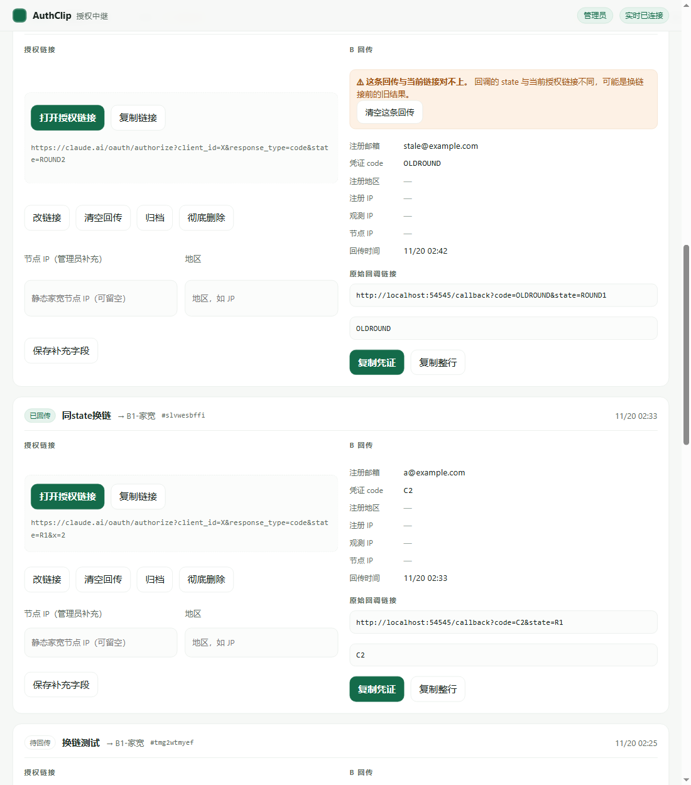

# AuthClip · 授权链接中继台（长期链接版）

两条长期链接，都不登录：

```
A：https://host/#a=<admin token>    ← 看板，下发授权链接、收 B 的回传
B：https://host/#b=<member token>   ← 收件箱，点开授权、把回调链接粘回来
```

A 把 Claude 授权链接丢给某个 B → B 点开走官方 OAuth → B 把地址栏那条
`http://localhost:54545/callback?code=…&state=…` 整条粘回来 → 系统自动切出 code / state
→ A 在卡片上「复制凭证」或「复制整行」。

## 一、起服务

```powershell
cd C:\AI\A\AuthClip

# 建人（打印长期链接）；-base 决定打印出来的域名
.\authclip.exe -dir=.\data -base=https://clip.example.com add admin "A-主号"
.\authclip.exe -dir=.\data -base=https://clip.example.com add member "B-小王"
.\authclip.exe -dir=.\data users            # 列出所有人和 id

# 起服务
.\authclip.exe -http=127.0.0.1:8090 -dir=.\data `
  -geo=.\geo\country.mmdb -trust-proxy=127.0.0.1/32 `
  -base=https://clip.example.com
```

| 参数 | 作用 |
| :--- | :--- |
| `-http` | 监听地址；局域网/公网用 `0.0.0.0:8090` |
| `-dir` | 数据目录（`state.json` 0600，原子写） |
| `-geo` | 可选 MMDB 国家库：用服务端观测 IP 判地区 |
| `-trust-proxy` | 可信反代 CIDR：只有这些来源的 `X-Real-IP` 才采信 |
| `-geo-url` | 可选：交给**浏览器**去查地域的端点（如 `https://ip.net.coffee/`），服务端不出站 |
| `-base` | 打印长期链接时用的对外地址 |

## 二、B 的完整动作（4 步）

1. 打开自己的长期链接 → 看到"待处理"的授权卡片
2. 点「① 打开授权链接」→ 在 Claude 官方页面登录/授权
3. 授权成功后浏览器跳到 `http://localhost:54545/callback?code=…`，**页面会显示"无法访问"——这是正常的**，本机没有监听 54545
4. 回到我们的页面：
   - 把地址栏整条 URL 复制粘贴进「③ 回调链接」框 → **自动切出 code，并校验 state 与本条授权链接是否一致**
   - 或点「读剪贴板并解析」（一次点击，Chrome/Edge 允许）
   - 填注册邮箱、注册地区，IP 默认已填服务端观测值，可改；静态家宽节点选填
   - 提交；再提交一次即覆盖

> **为什么不能全自动**：浏览器禁止读取其它标签页的地址栏，也禁止读 `ERR_CONNECTION_REFUSED`
> 页面的 DOM。所以「自动抓取」的可行上限就是**粘贴/读剪贴板 + 自动解析**，两步操作。
> 这不是实现取舍，是平台硬限制；任何声称能直接抓到的方案都要装扩展或本地代理。

### 页面上就有一张示意图

B 打开页面后，卡片上方是一张**内联 SVG 步骤图**（不引外部图片，CSP `style-src 'self'` 也放行）：
地址栏高亮 → `Ctrl+A` / `Ctrl+C` → 粘贴框 → `code` 已提取。图下配三行文字说明。

- 桌面宽度显示图 + 说明；**≤560px（手机）自动隐藏图，只留三行说明**，避免缩成看不清的小字。
- 图和说明只教「从地址栏整条复制」，不涉及在出错页面上点击/交互，因此不会触发任何站点限制。

### 弹窗打开 + 切回自动填

「打开授权链接」现在开**小窗**（`popup=yes,width=560,height=800,noopener`）：

| 能力 | 是否成立 | 原因 |
| :--- | :--- | :--- |
| 开小窗，授权完切回本页 | ✅ | 用户手势触发，弹窗拦截器放行 |
| 读弹窗里的地址栏 / 回调 URL | ❌ | 跨域（claude.ai → localhost:54545 又是另一个 origin）；且最后是 `ERR_CONNECTION_REFUSED` 错误页，无 DOM |
| 读弹窗里的表单 | ❌ | 同上 |
| 判断"用户回来了" | ✅ | `focus` / `visibilitychange` |
| 回来时自动读剪贴板并解析 | ⚠️ 视权限 | Chrome/Edge 首次会弹一次剪贴板读取授权；允许后静默成功，拒绝则退化为「读剪贴板并解析」按钮 |

`noopener` 的取舍：授权页拿不到 `window.opener`（防反向跳转劫持），代价是 `window.open` 返回 `null`，
所以「是否被拦」用 `document.hasFocus()` 做启发式，而不是靠返回值判断。

> 想 100% 全自动（不复制）只有一条路：把 `redirect_uri` 改成指向本服务的回调端点，由服务端收 code。
> 但那样 `code_challenge`(PKCE) 与 verifier 必须同源，而 verifier 在 B 本机的客户端里 —— 会破流程。
> 或者装一个能读当前标签 URL 的浏览器扩展。两者都需要改现有授权方式，所以默认不做。


## 三、A 的完整动作

| 动作 | 说明 |
| :--- | :--- |
| 下发 | 选接收人 + 粘贴授权链接 + 备注 → 对方刷新就能看到 |
| 新增接收人 | 面板里直接加，立刻给出可复制的长期链接 |
| 改链接 | 授权失效就换一条，B 的页面实时刷新，不用重发 |
| 复制凭证 | 一键拿 `code` |
| 复制整行 | `code ⇥ 邮箱 ⇥ 地区 ⇥ 注册IP ⇥ 节点IP`（制表符，可直接贴表格） |
| 补充节点 IP | B 没填时管理员补；也可改地区 |
| 清空回传 / 删除 | 拿走数据后抹掉凭证，或整条删掉 |

## 四、接口与鉴权

所有请求带 `X-Token` 头（token 只出现在 URL fragment `#a=` / `#b=`，永不进请求行、不进 Referer、不进反代日志）。

| 方法 | 路径 | 角色 | 说明 |
| :--- | :--- | :--- | :--- |
| GET | `/api/me` | 任意 | 我是谁 |
| GET | `/api/board` | admin | 接收人清单 + 全部任务 |
| POST | `/api/members` | admin | 新建接收人（返回长期链接） |
| POST | `/api/slots` | admin | 下发 `{member,link,label}` |
| PATCH | `/api/slots/{id}` | admin | 换链接 / 改接收人 / 补节点 IP / 改地区 / 改邮箱 |
| POST | `/api/slots/{id}/clear` | admin | 清空回传 |
| DELETE | `/api/slots/{id}` | admin | 删除 |
| GET | `/api/mine` | member | 我的任务 + 服务端观测 IP/地区 |
| POST | `/api/slots/{id}/report` | member | 回传 `{email,callback,code,reg_ip,reg_region,node_ip}` |
| GET | `/api/stream` | 任意 | SSE（fetch 流，token 走头） |

`callback` 可传整条 URL，服务端会兜底再解析一次；`code` 也可直接给（不带 URL）。

## 五、实测矩阵

| 用例 | 结果 |
| :--- | :--- |
| 伪造 token | 401 |
| member 调 `/api/board` / admin 调 `/api/mine` | 403 / 403 |
| 别人任务回传 | 404；且别人 `/api/mine` 里看不到 |
| `javascript:` 当授权链接 | 400 |
| **把授权链接当回调提交** | **400**（关键：授权链接里带 `code=true`，若不排除会被当成凭证——已修） |
| 回调链接 `…?code=rd5sfX1…&state=9f5eb6…` | code/state 双提取成功 |
| 只给 `code`（不带 URL） | 接受 |
| 坏邮箱 / 坏地区 / 坏节点 IP / 空凭证 | 400 / 400 / 400 / 400 |
| 注册 IP 留空 | 自动落服务端观测值（`X-Real-IP: 8.8.8.8` → `8.8.8.8` + 地区 `US`） |
| admin 补节点 IP + 改地区 | 生效，且不覆盖已回传的 code |
| `state.json` 中是否出现管理员地址 | **False** |
| SSE | `text/event-stream`，两端实时 |

## 六、设计红线

1. **对授权链接零出站**：`link`/`callback` 只当字符串存；全项目没有拿它们发请求的代码路径，连可达性都不校验。
2. **不记录管理员 IP**：admin 路由从不调用 `observed()`；无访问日志（`ErrorLog` 丢弃）。
3. **token 不进 URL 查询串**：只走 fragment + 请求头，反代日志抓不到。
4. **无过期**：任务只有「待回传 / 已回传」，A 随时换链接。

## 七、部署（Caddy）

```caddy
clip.example.com {
	reverse_proxy 127.0.0.1:8090 {
		header_up X-Real-IP {remote_host}
		flush_interval -1
	}
}
```

启动加 `-trust-proxy=127.0.0.1/32`，否则拿到的是反代地址。

## 八、数据

`data/state.json`（0600）：用户、token、授权链接、回传的 code/邮箱/IP/节点。凭证明文落盘，
拿走数据后点「清空回传」；整目录不要进备份/网盘。删用户请直接编辑该文件后重启（v1 未做用户删除接口）。

## 九、截图

| | |
| :--- | :--- |
| A 端看板 |  |
| B 端（桌面，含示意图） |  |
| B 端（手机） |  |

长期链接在界面上默认打码（点「显示」才展开），避免截屏/投屏时把 token 带出去。

## 十、v1.1.0 安全修复（针对上线前审查的三条阻断项）

审查对象：`authclip` 分支 `1578c8f`。三条均**复现于源码**，非误报。

### 1. 改派接收人泄露上一位的数据（已修）

- **问题**：`PATCH /api/slots/{id}` 换 `member` 时只改 `Member` 字段，旧 `code/callback/email/reg_ip/node_ip/seen_ip` 全部留在任务里；新接收人通过自己的 `/api/mine` 直接读到。且 `report` 的归属校验在事务外，改派并发时不会重新校验。
- **修复**：改派即调用 `clearReturned()` 抹掉全部回传与观测字段；`report` 在 `updateSlot` 闭包内**再校验一次** `s.Member == 用户`，不匹配返回 409「任务在提交期间发生变化」。
- **测试**：`TestReassignClearsReturnedData`、`TestReportAfterReassignRejected`。

### 2. 回传未与授权链接的 state 核对（已修）

- **问题**：只保存回传的 `state`，从不比对当前授权链接里的 `state`。任何人都能把别处的 code 塞进这条任务；任务换链接后旧回传也不会失效。
- **修复**：`linkStateOf(link)` 取授权链接的 `state`；回传时——
  - 链接有 state 而回传没有 → `400`「需要整条回调链接：其中必须带 state」
  - 两者不一致 → `409`「state 与当前授权链接不一致」
  - 事务内按**最新链接**再核一次（提交期间被换链接也会拒）
- **测试**：`TestReportRejectsForeignState`、`TestLinkStateParsing`。

### 3. 长期令牌可经 URL 查询参数泄露（已修）

- **问题**：`wrap()` 里 `?t=` 兜底（早先给 EventSource 用）——令牌会进访问日志、浏览器历史、反代日志。
- **修复**：只认 `X-Token` 请求头；前端本就改用 `fetch` 流式读 SSE，无需查询串。
- **静态存储**：设置 `AUTHCLIP_SECRET` 后，整个状态文件以 **AES-256-GCM** 落盘为 `state.bin`（令牌 + OAuth 回传数据一起加密），旧的 `state.json` 会自动迁移并删除；未设置时启动日志会明确警告。
- **测试**：`TestTokenFromQueryRejected`、`TestStoreEncryptionAtRest`。

### 实测输出（`scripts/verify-fixes.ps1`）

```
state 不一致        -> 409
缺 state            -> 400
state 一致          -> 200
改派后 B2 看到: email='' code='' callback='' reg_ip='' node=''
被改派者 B1 再回传  -> 404
查询参数 ?t=        -> 401        请求头 X-Token -> 200
state.bin 中出现 admin token 明文: False      state.json 存在: False
```

## 十一、Go 版本与漏洞公告

**构建要求：Go ≥ 1.27.4**（`go.mod` 已钉 `go 1.27.4`）。`go1.27.0~1.27.3` 的标准库带 15 条公告，
其中 7 条在本服务可达（`net/http` 服务端、`os.MkdirAll`、`http.MaxBytesReader` 等）。

| 公告 | 修复于 | 影响本服务 | 说明 |
| :--- | :--- | :--- | :--- |
| **GO-2026-6859** | **1.27.4** | **是** | `net/http` MaxBytesReader header race 导致 HTTP/1 服务端崩溃；本服务在 `decode()` 里直接用它 |
| GO-2026-6609 | 1.27.2 | 是 | Range 头无长度上限；`http.FileServer` 提供静态资源 |
| GO-2026-6603 | 1.27.2 | 否（不启 h2） | HTTP/2 Trailer 内存耗尽；Caddy 终结 TLS，后端只跑 HTTP/1.1 |
| GO-2026-6610 / 6611 / 6612 / 6617 | 1.27.2 | 否（不启 h2） | HTTP/2 分帧、流控、HPACK 竞争 |
| GO-2026-6613 | 1.27.2 | 否 | HTTP/1 服务端 CONNECT 失步；未接受 CONNECT |
| GO-2026-6605 | 1.27.2 | 否 | HTTP/1 **客户端** CONNECT；本服务无出站请求 |
| GO-2026-6604 | 1.27.2 | 是（仅 Windows） | `os.MkdirAll` 可跟随 junction；`openStore` 会建目录 |
| GO-2026-6608 | 1.27.2 | 否 | MIME 头解析；不处理 multipart |
| GO-2026-6607 | 1.27.2 | 否 | crypto/tls ECH；不做 TLS 终结 |
| GO-2026-6599 / 6600 | 1.27.2 | 否 | html/template / regexp；未使用 html/template |
| GO-2026-6809 | 1.27.3 | 否 | crypto/x509 中间证书；无出站 TLS 校验证书 |

验证方式与结果：

```text
OSV stdlib@1.27.0 → 15 条（含 GO-2026-6859）
OSV stdlib@1.27.4 → none
govulncheck ./...（go1.27.4 构建）→ No vulnerabilities found
go version -m authclip.exe → go1.27.4
```

> 注意：`govulncheck` 按**实际构建用的工具链**判定。审查环境若用 1.27.0~1.27.3 编译，
> 即使 `go.mod` 写 1.27.4 也会命中；CI 需确认 `go version` 输出。

## 十二、账号、权限分发与审计（v1.2.0）

之前的模型只有「管理员 / 接收人」两层，建号只能靠 CLI，也没有吊销和留痕。v1.2 补齐：

### 三种身份

| 身份 | 范围 | 能做什么 | 看不到什么 |
| :--- | :--- | :--- | :--- |
| 接收人 `member` | — | 只看到派给自己的任务；提交/覆盖回传 | 别人的任务、任何人的链接 |
| 管理员·限自己 `admin/own` | 自己创建的任务 | 下发、改派、清空、删除**自己名下**任务；创建接收人 | 别人的任务、接收人的长期链接、账号列表、审计 |
| 管理员·全量 `admin/all` | 全部 | 全部任务 + 账号管理 + 轮换/吊销 + 审计 | — |

`scope` 为空的历史管理员按 `all` 处理（向后兼容）。

### 账号管理接口（均需 `all`）

| 方法 | 路径 | 说明 |
| :--- | :--- | :--- |
| GET | `/api/users` | 列账号（含角色/范围/吊销状态） |
| POST | `/api/users` | 建账号 `{role,scope,label}`，**长期链接只在这里返回一次** |
| PATCH | `/api/users/{id}` | 改标签 / 改范围 / 吊销 `{revoke:true|false}` |
| POST | `/api/users/{id}/rotate` | 轮换长期链接，**旧链接立即失效** |
| DELETE | `/api/users/{id}` | 删除（名下还有任务时拒绝） |
| GET | `/api/audit` | 最近 100 条操作 |

保护规则：不能吊销/删除自己；`own` 管理员不能改自己的范围、不能升自己为全量。

### 命令行的范围参数

```sh
authclip -dir ./data add admin "A-主号" all     # 默认 all
authclip -dir ./data add admin "A2-外包" own    # 只能管自己下发的
authclip -dir ./data add member "B1-家宽"
authclip -dir ./data users                      # 显示 role / scope / id / 标签 / 是否吊销
```

### 审计

每次 `slot.create / slot.reassign / slot.update / slot.clear / slot.delete / slot.report`
以及 `user.create / user.update / user.revoke / user.restore / user.rotate / user.delete`
都会写一条 `{时间, 操作者 id+标签, 动作, 任务, 对象}`，**不含凭证内容**；最多保留 500 条。

### 权限相关的测试

```
PASS TestOwnScopeAdminIsIsolated   限自己管理员：看不到他人任务/链接/账号/审计，改他人任务 404
PASS TestRevokedLinkStopsWorking   吊销后 401，恢复后 200
PASS TestRotateInvalidatesOldToken 轮换后旧 token 失效、新 token 可用
PASS TestSelfProtection            不能吊销/删除自己
PASS TestAuditTrail                审计里能查到 slot.create / slot.reassign
```

## 十三、归档、历史、导出与留存期（v1.3.0）

### 归档而不是硬删除

`DELETE /api/slots/{id}` 现在是**归档**：任务从 A 的看板消失，但 B 的页面多出「历史（只读）」，能看到自己当初提交的邮箱/code/地区/IP。

- 归档后**不能再回传**（服务端 404，不只是前端隐藏按钮）
- `DELETE /api/slots/{id}?purge=1` 才是彻底删除（需 `all` 权限），B 的历史也一并清除

### 导出（A 端批量）

| 方式 | 说明 |
| :--- | :--- |
| 页面按钮 | 顶栏「导出 CSV / 导出 JSON」（仅 `all` 管理员可见） |
| `GET /api/export?format=csv` | 字段：id、备注、状态、接收人、下发人、邮箱、凭证、注册地区、注册IP、观测IP、节点IP、创建时间、回传时间、已归档 |
| JSON | 同数据，含 `deleted / submitted / state_param` 等完整字段 |

导出**包含已归档任务**，导出动作本身也会写一条审计 `data.export`。

### 留存期

```sh
authclip -http=0.0.0.0:8090 -dir=./data -retain-days 30
```

- `0`（默认）= 归档任务永久保留，B 的历史也永久可查
- `N>0` = 归档超过 N 天的任务在启动时与每 6 小时清理一次，**B 的历史同步消失**

> 关于「7 天」：7 天会把你刚导出完的数据从服务端抹掉，而且不可恢复（加密状态下也无从重建）。
> 建议先用默认 0（永久），确认导出流程跑通后再设 30 天；真要 7 天，务必保证每日导出。

### 权限收紧

`POST /api/members` 现在**只有 `all` 管理员能调**。原因：建人等于分发一条拥有该接收人全部权限的长期链接，
受限管理员若能自建身份，就能绕过「只能管自己任务」的边界。`own` 管理员需要新接收人时，找全量管理员建。

### 测试

```
PASS TestArchiveKeepsMemberHistory   归档后看板不显示、B 历史仍在、且不能再回传
PASS TestPurgeOnlyForAllScope        彻底删除需 all；own 访问他人任务仍 404
PASS TestOwnScopeCannotCreateMember  own 建接收人 403，all 正常
PASS TestExportCSV                   导出含已归档行与表头；own 导出 403
```

## 十四、v1.3.1 安全修复（针对 5498aea 审查）

审查对象 `5498aea`。三条均复现于源码。

### 1. 账号列表暴露长期令牌

- **问题**：`GET /api/users` 直接序列化 `[]User`，`Token` 字段一并返回；`/api/board` 的接收人列表也带 `token/link`。任何 `all` 管理员（或拿到其链接的人）可批量导出所有人的身份凭证。
- **修复**：两个列表都改成投影，**不含 token/link**。要发链接只有一条路：`POST /api/users/{id}/rotate` —— 签发新链接（旧链接同时失效），只显示一次，并记 `user.rotate` 审计。
- **代价**：A 端不能再"查看已有链接"，只能"重新生成"。界面已改成「重新生成链接」。

### 2. OAuth 回传校验缺口

- **问题**：`linkStateOf(link)` 为空时整段校验被跳过；且 `parseCallback` 接受裸 code，服务端无法确认 code 与本次回调同源。
- **修复**：
  - 建任务/改链接**必须带 state**，否则 `400`；
  - 回传**只接受整条回调链接**（含 `code=` 与 `state=`），裸 code 一律 `400`；
  - 链接缺 state 的历史数据：回传直接 `409`，提示管理员更新链接；
  - 事务内按**最新链接**的 state 再核一次。
- 影响：B 侧必须从地址栏复制整条 URL（前端本来就引导这么做），`TOKEN#VERIFIER` 这类裸凭证不再可提交。

### 3. 导出含凭据 + 审计写在输出之后

- **问题**：导出直接吐明文 code/callback/邮箱/IP；`appendAudit` 在 `cw.Flush()` 之后，客户端可能已收完数据而审计失败/丢失。
- **修复**：
  - 默认**脱敏**：凭证 `前4……后2（长度）`、邮箱 `前2***@域名`、IP `a.b.x.x`；CSV 增列「导出模式」；
  - 完整凭据需 `?secrets=1&confirm=EXPORT` 二次确认，界面按钮带 `confirm` 弹窗；
  - **审计先写、再输出**，且区分 `mode=masked|full`。

### 实测

```
/api/users 字段:      created,id,label,revoked,role,scope      ← 无 token
/api/board members:   created,id,label,revoked                 ← 无 token/link
缺 state 的链接    -> 400 授权链接缺少 state 参数…
裸 code 回传       -> 400 请粘贴整条回调链接…不接受单独的授权码
默认导出           -> 凭证 ***/……、邮箱 b1***@example.com、mode=masked
secrets=1 无 confirm -> 400
```

### 新增测试（共 19 个）

```
PASS TestUserListNeverReturnsTokens            列表与看板都不含 token/link
PASS TestLinkMustCarryState                    建/改链接缺 state 一律 400
PASS TestReportRequiresFullCallbackURL         裸 code 400、缺 state 400、完整回调通过
PASS TestExportIsMaskedByDefaultAndAuditedFirst 默认脱敏、完整导出需确认、审计区分模式
```

## 十五、v1.3.2：单条取链接（对 v1.3.1 的折中）

v1.3.1 为了堵"账号列表暴露令牌"，把查看链接的能力一并砍了——A 端只能「重新生成」，而重新生成会让 B 手上那条立即失效。副作用比风险本身更烦。

v1.3.2 折中：

| 接口 | 行为 |
| :--- | :--- |
| `GET /api/users`、`/api/board` | **仍然不含任何 token/link**（没有批量出口） |
| `GET /api/users/{id}/link` | 按单条、按需取一次链接；**每次写 `user.link` 审计**；已吊销账号返回 409 |
| `POST /api/users/{id}/rotate` | 需要作废旧链接时才用 |

界面：接收人一行「查看链接」（取到即复制，并提示"此次查看已记审计"）+「重新生成链接」。

实测：

```
列表字段:        created,id,label,revoked          ← 无 token
单条取链接:      http://…/#b=z4kxhiija…             ← 200
审计最新:        {"action":"user.link","target":"hd2mzjqcxj:B1-家宽"}
```

新增测试 `TestLinkRevealIsPerRequestAndAudited`（共 20 个）：列表无 token、单条可取、own 范围 403、吊销 409、审计留痕。

## 十六、按用户名下发（v1.4.0）

之前下拉框里是 `标签 · id前4位`，而**标签不唯一**（两个「B-家宽」就分不清）。v1.4 给每个账号加了唯一 `username`。

### 规则

| 项 | 说明 |
| :--- | :--- |
| 格式 | 小写 `a-z0-9._-`，2–32 位；空格转 `-`，其它字符丢弃 |
| 生成 | 创建时可显式指定；不填则由标签派生；纯中文/符号标签回落到 `user-xxxx` |
| 唯一性 | 全库唯一（含管理员）；显式指定重复 → `409 用户名已被占用` |
| 解析 | `POST /api/slots` 的 `member` 字段现在**接受用户名或 id**，大小写不敏感 |
| 改名 | `PATCH /api/users/{id}` 支持 `{username}`，改名后旧名立即失效 |
| 老数据 | 启动时自动补齐（`migrateUsernames`），无需手工处理 |

### 界面

下发表单从下拉框换成**输入框 + datalist**：

```
接收人（用户名）  [ b1            ]      ← 可直接输用户名
                  → B1-家宽（b1）        ← 实时显示会发给谁
```

用户名叫不准时打名字也能匹配（`张三` → 命中后显示其 username）；已吊销的接收人不在候选里，手输会提示不能下发。

### 命令行

```sh
authclip -dir ./data add member "B1-家宽" b1      # 第 3 个参数是用户名
authclip -dir ./data users                        # 显示 角色/范围/用户名/id/标签/吊销
```

### 测试（共 22 个）

```
PASS TestUsernameUniquenessAndLookup   重名 409、按用户名下发、未知用户名 400、改名后旧名失效
PASS TestUsernameBackfilledForLegacyData 老数据自动补齐（Legacy User → legacy-user）
```

## 十七、v1.4.1 安全修复（针对 6096cde 审查）

### 1. 仍可取出其他管理员的登录链接

- **问题**：`GET /api/users/{id}/link` 与 `POST /api/users/{id}/rotate` 只校验调用者是 `all`，不校验目标角色。拿到另一个管理员的 `#a=` 就等于接管其身份。
- **修复**：两个接口都**只对 `member` 角色开放**；管理员目标返回 `403`。管理员链接只在创建时下发一次，遗失请在服务器上用 `authclip link admin 标签`（需要主机权限，属可信边界）。
- 实测：取其他管理员 `403`、取自己 `403`、取接收人 `200`。

### 2. 审计写入失败时仍返回敏感数据

- **问题**：`appendAudit` 内部 `_ = s.saveLocked()`，忽略落盘错误；导出与取链接都是"先审计后返回"，但审计其实可能悄悄失败。
- **修复**：`appendAudit` 改为**返回错误并回滚内存里的那条审计**；`data.export`、`user.link`、`user.rotate` 改为 **fail-closed**——审计写不进去就 `500`，不吐数据。
- 实测：把存储路径改成目录制造写失败，导出 `500` 且响应体不含凭证；取链接同样 `500`。

### 3. 换授权链接后旧回传仍在

- **问题**：`patchSlot` 换 `link` 时只改字段，不清 `code/callback/email/ip`。管理员容易把上一轮的 code 当成本轮结果。
- **修复**：换链接且 **state 发生变化**即视为新一轮，调用 `clearReturned()`；同一条链接重复写入（state 未变）不清空。审计动作为 `slot.relink`。
- 实测：`ROUND1 → ROUND2` 后 `code/email/callback/state` 全空，审计多一条 `slot.relink`。

### 测试（共 25 个）

```
PASS TestCannotFetchOrRotateAdminLink      管理员链接 403（他人/自己），接收人 200
PASS TestAuditFailureBlocksSensitiveOutput 写盘失败时导出/取链接 500 且不含数据
PASS TestRelinkClearsPreviousResult        换 state 清回传并记 slot.relink；同 state 不清
```

## 十八、v1.4.2：管理员链接可取（策略调整）

v1.4.1 把 `GET /api/users/{id}/link` 与 `rotate` 收紧成"只能操作接收人"，实际使用中会卡住：

- 全量管理员**本就已经**拥有建号 / 删号 / 吊销 / 改派 / 改范围的全部权限；
- 藏起链接不构成任何额外防护，只是让"帮同事找回链接"变成必须登服务器跑 CLI；
- 真正需要防的不是"管理员能拿"，而是"拿了没痕迹"。

因此 v1.4.2 放开角色限制，保留三条底线：

| 底线 | 行为 |
| :--- | :--- |
| 已吊销账号 | `409`，不给链接（避免用吊销身份继续操作） |
| 每次取用都留审计 | `user.link`，target 记录 `id:标签:角色[:范围]`，管理员目标可区分 |
| 审计失败即拒答 | 落盘失败 → `500`，不返回链接（fail-closed） |
| 不能轮换自己 | `400`：那只会让自己当前链接立即失效，属误操作 |

实测（同一实例，全局管理员 A）：

```
admin/a      -> http://…/#a=dk2wwwzzw7kaql5…     ← 自己
admin/a2     -> http://…/#a=2mbhfqltymnkddm…     ← 另一个管理员
member/b1    -> http://…/#b=z4kxhiijac5tgbu…     ← 接收人
审计 target:  2ukekktbhq:A-主号:admin:all
              ehg6ar2u4m:A2-限自己:admin:own
              hd2mzjqcxj:B1-家宽:member
```

仍然保留 v1.4.1 的另外两条修复：审计 fail-closed、换链接清旧回传。

测试：`TestGlobalAdminMayFetchAnyLinkButAlwaysAudited`（取任意账号 200、三条审计、轮换他人允许、轮换自己 400、吊销 409），共 25 个全绿。

## 十九、换链接后旧回传的清理（v1.4.3）

### 问题

A 端「改链接」原本只替换 `link` 字段，`code / callback / email / ip` 原样保留。接收人没变时，
上一轮的凭证会挂在新链接下面，管理员很容易把它当成本轮结果。

### 修复分两步

**第一步（v1.4.1）**：`state` 变化即视为新一轮，`clearReturned()`。

**第二步（v1.4.3，补漏）**：判定从「state 是否变化」改成「**链接是否变化**」。
理由：新链接可能沿用同一个 `state`（只换了 `code_challenge` 或参数顺序），
这种情况旧回传同样失效，但按 state 比较会漏掉。

```go
if next != s.Link {
    if keep_result { /* 显式保留，记账 */ } else { clearReturned(s) }
}
```

| 场景 | 行为 |
| :--- | :--- |
| 换新链接（state 变） | 清空回传，审计 `slot.relink` |
| 换新链接（state 没变，仅其它参数变） | **同样清空** |
| 原样重复保存同一条链接 | 不清空（避免手滑） |
| 勾选「保留已有回传」 | 保留，审计 `slot.relink.keep`（留痕） |

### 界面

「改链接」面板会提示当前任务是否已有回传；已有时给出警告，并提供一个
**默认不勾选**的「保留已有回传（仅当链接写错但结果仍属本轮）」开关。
另外卡片上本来就有「state 不一致」徽标：`state_param` 与当前链接的 `state` 不符时会标出，
历史遗留的错配数据能一眼看到。

### 实测

```
同 state 换链接        -> code='' state=''        （清空）
显式 keep 换链接       -> code='C2'               （保留）
审计                   -> slot.relink.keep | slot.report | slot.relink | …
```

测试：`TestRelinkClearsRegardlessOfState`（三种场景 + 审计动作区分），共 26 个全绿。

## 二十、错配回传的现场拦截（v1.4.4）

导出是收尾动作，不能当作日常核对手段。v1.4.4 把"这条回传是不是本轮的"判断搬到**日常看板与复制动作**上：

| 位置 | 行为 |
| :--- | :--- |
| 顶部汇总条 | `⚠ 有 N 条任务的回传与当前链接对不上`，一眼看到总数 |
| 卡片内 | 红框提示「这条回传与当前链接对不上」，附**一键「清空这条回传」** |
| 复制凭证 / 复制整行 | 若该卡片错配，先弹确认「可能来自上一轮，仍要复制吗？」 |
| 判定 | `state_param` 与当前链接的 `state` 不一致；**链接本身没有 state 时也算错配**（无法核对来源） |

这样即使不做导出、不去比对 CSV，也不会在正常流程里把上一轮的 code 当成本轮结果。



## 二十一、v1.4.5：链接代次（并发写回）与管理员链接不可读

### 1. 换链接与提交并发时，旧回传仍可能写回

- **问题**：v1.4.3/v1.4.4 解决的是"换链之后旧数据还在"，但没解决**在途请求**。提交时只比对 `state`；若新旧链接沿用同一个 `state`，一条在清空之前发出的请求，仍可在清空之后把上一轮结果写回来——前端也识别不出（`state` 看起来是匹配的）。
- **修复**：给任务加**链接代次** `link_gen`，换链接即 +1。

| 环节 | 行为 |
| :--- | :--- |
| `Slot.LinkGen` | 创建时 1，每次换链 +1（含"显式保留"的情况） |
| B 的页面 | `/api/mine` 拿到 `link_gen`，提交时必须回传 |
| 服务端 | 缺 `link_gen` → `400`；代次不符 → `409 授权链接已更换，请刷新` |
| 事务内 | 再比一次代次，杜绝"读校验通过、写之前被换链" |

实测：

```
创建 gen=1
gen=1 提交 -> 200
换链后 gen=2（旧回传已清）
gen=1 提交 -> 409       code 仍为 ''
gen=2 提交 -> 200       code = C2
```

### 2. 全量管理员仍能获取其他管理员的长期登录链接

- **问题**：审计能记下"谁读了链接"，但读完之后的动作发生在**被冒用者身份**下，日志会记成对方；事后无法区分"本人操作"与"他人代操作"。
- **修复**：`GET /api/users/{id}/link` 恢复为**只对接收人开放**。管理员需要恢复访问时走 `POST /api/users/{id}/rotate`——它会让旧链接**立即失效**（冒用窗口关闭），动作记在操作者名下，响应里附带提示"请私下交给本人"。
- 代价：不能"悄悄看一眼"某个管理员的链接；这是有意的。

实测：

```
GET /api/users/<管理员>/link -> 403 管理员链接不可读取…请用「重置链接」
GET /api/users/<接收人>/link -> 200 http://…/#b=…
```

### 测试（共 27 个）

```
PASS TestReportRejectedAfterRelinkEvenWithSameState  同 state 换链后旧代次 409、新代次 200、缺 link_gen 400
PASS TestAdminLinkNotReadableButRotatable             管理员链接 403，接收人 200，轮换仍可用
```
