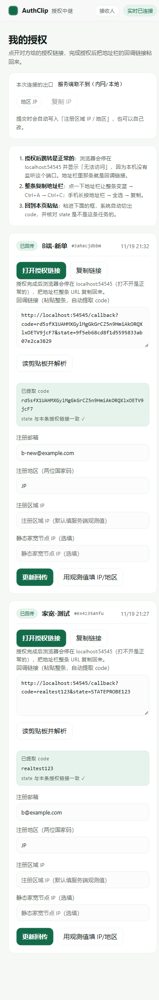

# AuthClip · 授权链接中继台（长期链接版）

两条长期链接，都不登录：

```
A：https://host/#a=<admin token>    ← 看板，下发授权链接、收 B 的回传
B：https://host/#b=<member token>   ← 收件箱，点开授权、把回调链接粘回来
```

A 把 Claude 授权链接丢给某个 B → B 点开走官方 OAuth → B 把地址栏那条
`http://localhost:54545/callback?code=…&state=…` 整条粘回来 → 系统自动切出 code / state
→ A 在卡片上「复制凭证」或「复制整行」。

## 一、起服务

```powershell
cd C:\AI\A\AuthClip

# 建人（打印长期链接）；-base 决定打印出来的域名
.\authclip.exe -dir=.\data -base=https://clip.example.com add admin "A-主号"
.\authclip.exe -dir=.\data -base=https://clip.example.com add member "B-小王"
.\authclip.exe -dir=.\data users            # 列出所有人和 id

# 起服务
.\authclip.exe -http=127.0.0.1:8090 -dir=.\data `
  -geo=.\geo\country.mmdb -trust-proxy=127.0.0.1/32 `
  -base=https://clip.example.com
```

| 参数 | 作用 |
| :--- | :--- |
| `-http` | 监听地址；局域网/公网用 `0.0.0.0:8090` |
| `-dir` | 数据目录（`state.json` 0600，原子写） |
| `-geo` | 可选 MMDB 国家库：用服务端观测 IP 判地区 |
| `-trust-proxy` | 可信反代 CIDR：只有这些来源的 `X-Real-IP` 才采信 |
| `-geo-url` | 可选：交给**浏览器**去查地域的端点（如 `https://ip.net.coffee/`），服务端不出站 |
| `-base` | 打印长期链接时用的对外地址 |

## 二、B 的完整动作（4 步）

1. 打开自己的长期链接 → 看到"待处理"的授权卡片
2. 点「① 打开授权链接」→ 在 Claude 官方页面登录/授权
3. 授权成功后浏览器跳到 `http://localhost:54545/callback?code=…`，**页面会显示"无法访问"——这是正常的**，本机没有监听 54545
4. 回到我们的页面：
   - 把地址栏整条 URL 复制粘贴进「③ 回调链接」框 → **自动切出 code，并校验 state 与本条授权链接是否一致**
   - 或点「读剪贴板并解析」（一次点击，Chrome/Edge 允许）
   - 填注册邮箱、注册地区，IP 默认已填服务端观测值，可改；静态家宽节点选填
   - 提交；再提交一次即覆盖

> **为什么不能全自动**：浏览器禁止读取其它标签页的地址栏，也禁止读 `ERR_CONNECTION_REFUSED`
> 页面的 DOM。所以「自动抓取」的可行上限就是**粘贴/读剪贴板 + 自动解析**，两步操作。
> 这不是实现取舍，是平台硬限制；任何声称能直接抓到的方案都要装扩展或本地代理。

### 页面上就有一张示意图

B 打开页面后，卡片上方是一张**内联 SVG 步骤图**（不引外部图片，CSP `style-src 'self'` 也放行）：
地址栏高亮 → `Ctrl+A` / `Ctrl+C` → 粘贴框 → `code` 已提取。图下配三行文字说明。

- 桌面宽度显示图 + 说明；**≤560px（手机）自动隐藏图，只留三行说明**，避免缩成看不清的小字。
- 图和说明只教「从地址栏整条复制」，不涉及在出错页面上点击/交互，因此不会触发任何站点限制。

### 弹窗打开 + 切回自动填

「打开授权链接」现在开**小窗**（`popup=yes,width=560,height=800,noopener`）：

| 能力 | 是否成立 | 原因 |
| :--- | :--- | :--- |
| 开小窗，授权完切回本页 | ✅ | 用户手势触发，弹窗拦截器放行 |
| 读弹窗里的地址栏 / 回调 URL | ❌ | 跨域（claude.ai → localhost:54545 又是另一个 origin）；且最后是 `ERR_CONNECTION_REFUSED` 错误页，无 DOM |
| 读弹窗里的表单 | ❌ | 同上 |
| 判断"用户回来了" | ✅ | `focus` / `visibilitychange` |
| 回来时自动读剪贴板并解析 | ⚠️ 视权限 | Chrome/Edge 首次会弹一次剪贴板读取授权；允许后静默成功，拒绝则退化为「读剪贴板并解析」按钮 |

`noopener` 的取舍：授权页拿不到 `window.opener`（防反向跳转劫持），代价是 `window.open` 返回 `null`，
所以「是否被拦」用 `document.hasFocus()` 做启发式，而不是靠返回值判断。

> 想 100% 全自动（不复制）只有一条路：把 `redirect_uri` 改成指向本服务的回调端点，由服务端收 code。
> 但那样 `code_challenge`(PKCE) 与 verifier 必须同源，而 verifier 在 B 本机的客户端里 —— 会破流程。
> 或者装一个能读当前标签 URL 的浏览器扩展。两者都需要改现有授权方式，所以默认不做。


## 三、A 的完整动作

| 动作 | 说明 |
| :--- | :--- |
| 下发 | 选接收人 + 粘贴授权链接 + 备注 → 对方刷新就能看到 |
| 新增接收人 | 面板里直接加，立刻给出可复制的长期链接 |
| 改链接 | 授权失效就换一条，B 的页面实时刷新，不用重发 |
| 复制凭证 | 一键拿 `code` |
| 复制整行 | `code ⇥ 邮箱 ⇥ 地区 ⇥ 注册IP ⇥ 节点IP`（制表符，可直接贴表格） |
| 补充节点 IP | B 没填时管理员补；也可改地区 |
| 清空回传 / 删除 | 拿走数据后抹掉凭证，或整条删掉 |

## 四、接口与鉴权

所有请求带 `X-Token` 头（token 只出现在 URL fragment `#a=` / `#b=`，永不进请求行、不进 Referer、不进反代日志）。

| 方法 | 路径 | 角色 | 说明 |
| :--- | :--- | :--- | :--- |
| GET | `/api/me` | 任意 | 我是谁 |
| GET | `/api/board` | admin | 接收人清单 + 全部任务 |
| POST | `/api/members` | admin | 新建接收人（返回长期链接） |
| POST | `/api/slots` | admin | 下发 `{member,link,label}` |
| PATCH | `/api/slots/{id}` | admin | 换链接 / 改接收人 / 补节点 IP / 改地区 / 改邮箱 |
| POST | `/api/slots/{id}/clear` | admin | 清空回传 |
| DELETE | `/api/slots/{id}` | admin | 删除 |
| GET | `/api/mine` | member | 我的任务 + 服务端观测 IP/地区 |
| POST | `/api/slots/{id}/report` | member | 回传 `{email,callback,code,reg_ip,reg_region,node_ip}` |
| GET | `/api/stream` | 任意 | SSE（fetch 流，token 走头） |

`callback` 可传整条 URL，服务端会兜底再解析一次；`code` 也可直接给（不带 URL）。

## 五、实测矩阵

| 用例 | 结果 |
| :--- | :--- |
| 伪造 token | 401 |
| member 调 `/api/board` / admin 调 `/api/mine` | 403 / 403 |
| 别人任务回传 | 404；且别人 `/api/mine` 里看不到 |
| `javascript:` 当授权链接 | 400 |
| **把授权链接当回调提交** | **400**（关键：授权链接里带 `code=true`，若不排除会被当成凭证——已修） |
| 回调链接 `…?code=rd5sfX1…&state=9f5eb6…` | code/state 双提取成功 |
| 只给 `code`（不带 URL） | 接受 |
| 坏邮箱 / 坏地区 / 坏节点 IP / 空凭证 | 400 / 400 / 400 / 400 |
| 注册 IP 留空 | 自动落服务端观测值（`X-Real-IP: 8.8.8.8` → `8.8.8.8` + 地区 `US`） |
| admin 补节点 IP + 改地区 | 生效，且不覆盖已回传的 code |
| `state.json` 中是否出现管理员地址 | **False** |
| SSE | `text/event-stream`，两端实时 |

## 六、设计红线

1. **对授权链接零出站**：`link`/`callback` 只当字符串存；全项目没有拿它们发请求的代码路径，连可达性都不校验。
2. **不记录管理员 IP**：admin 路由从不调用 `observed()`；无访问日志（`ErrorLog` 丢弃）。
3. **token 不进 URL 查询串**：只走 fragment + 请求头，反代日志抓不到。
4. **无过期**：任务只有「待回传 / 已回传」，A 随时换链接。

## 七、部署（Caddy）

```caddy
clip.example.com {
	reverse_proxy 127.0.0.1:8090 {
		header_up X-Real-IP {remote_host}
		flush_interval -1
	}
}
```

启动加 `-trust-proxy=127.0.0.1/32`，否则拿到的是反代地址。

## 八、数据

`data/state.json`（0600）：用户、token、授权链接、回传的 code/邮箱/IP/节点。凭证明文落盘，
拿走数据后点「清空回传」；整目录不要进备份/网盘。删用户请直接编辑该文件后重启（v1 未做用户删除接口）。

## 九、截图

| | |
| :--- | :--- |
| A 端看板 |  |
| B 端（桌面，含示意图） |  |
| B 端（手机） |  |

长期链接在界面上默认打码（点「显示」才展开），避免截屏/投屏时把 token 带出去。
